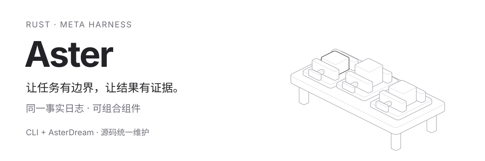

# Aster

**把模型的建议，变成有边界、有记录、可验证的执行。**

Aster 提供终端编程工具 **Aster CLI** 和桌面工作台 **Aster Work**。
它们使用本仓库维护的 Rust Harness：连接模型、组织上下文、调用工具，并由宿主控制权限和完成条件。

[快速开始](#快速开始) · [理解 Meta Harness](#理解-meta-harness) · [开发 Aster Work](#开发-aster-work) · [参与开发](#参与开发)



**读图：**固定底座代表内核边界；三个工位表示任务中的推演、执行和核验。
这是任务过程的概念示意，实际组件见下文。
[打开交互图源码](assets/readme/hairline-workbench.html)，下载后用浏览器打开，移动指针或按 **play** 查看三个工位。

## 从一个任务理解 Aster

假设你提出：“修复配置解析的问题，并运行相关测试。”

一个能交付这项工作的系统，需要把四件事接起来：

| 要解决的问题 | Aster 中的责任 |
| --- | --- |
| 接下来做什么？ | 模型根据任务和当前上下文提出下一步。 |
| 这一步允许执行吗？ | 宿主权限策略在工具调用前作出决定。 |
| 实际发生了什么？ | 工具结果和控制事件进入同一份事实日志。 |
| 结果达到完成条件了吗？ | 内核依据本次修改对应的验证证据判定是否可以完成。 |

因此，一次任务沿着这条路径推进：

```text
用户任务 → 模型提案 → 权限判定 → 工具执行 → 结果写入事实日志
                       │                         │
                       └─ 等待确认 / 拒绝         └─ 更新上下文，继续推演

发生修改的运行 → 与修改摘要绑定的验证报告 / 宿主显式豁免 → 完成门禁
```

模型、工具和界面可以替换。这些责任之间的边界由执行内核维持。

## 快速开始

需要 **rustup、C/C++ 工具链、CMake、protoc、just 和 Python 3.11+**。
Rust 版本由 [rust-toolchain.toml](rust-toolchain.toml) 固定；macOS 还需要 Xcode Command Line Tools。
Linux 桌面依赖见 [CI 安装步骤](.github/workflows/ci.yml)。

```sh
git clone git@github.com:aster-ai-lab/aster.git
cd aster
```

先将模型配置写入 `~/.a3s/config.acl`。以下是 OpenAI 兼容接口的最小示例；
将接口地址和 `model-id` 替换为你的服务信息，并在本机环境中设置 `OPENAI_API_KEY`：

```acl
default_model = "openai/model-id"

providers "openai" {
  base_url = "https://your-provider.example/v1"
  api_key = env("OPENAI_API_KEY")
  models "model-id" {}
}
```

更多选项见 [ACL 配置示例](crates/code/agent.example.acl)。
也可以用 `A3S_CONFIG` 指定配置文件，在终端中通过 `/config` 管理模型。
密钥留在本机配置或环境中；工作区配置受信任边界约束。

```sh
just code
just code --cwd /path/to/project
```

`just code` 先编译 `aster` 和 `a3s-code-acp`，再启动终端。
启动屏使用缓存的星芒轨道 ASCII 动画，并适配较小的终端。

> **macOS 当前限制：**原生 Shell 工具被上游进程生命周期保护拒绝，错误为
> `native_process_lifetime_unqualified`。界面、模型对话和文件工具已有本地验证；
> 依赖 Shell 的完整编程流程仍需通过平台资格验证。详见 [验证记录](docs/validation.md)。

<details>
<summary>直接使用 Cargo、发布模式和本地安装</summary>

默认成员会同时构建 CLI 和 ACP。两个可执行文件需要放在同一目录；
`A3S_ACP_AGENT_BIN` 可以显式指定 ACP 路径。支持 `CARGO_TARGET_DIR`。

```sh
cargo build --locked
./target/debug/aster --cwd /path/to/project

cargo build --locked --release
./target/release/aster

cargo install --locked --path crates/code/acp
cargo install --locked --path apps/aster
aster
```

仅运行 `cargo run -p aster` 时，需要先构建 ACP。
源码版本通过重新构建更新，上游二进制自动更新已停用。

</details>

## 理解 Meta Harness

**Harness 把一次模型调用接入可执行的任务过程；Meta Harness 让宿主在同一内核上组合这个过程。**

这里的 **Meta** 指 Harness 本身可以被装配：宿主选择部件和扩展组件来组织任务行为。
每个组件从事实记录计算当前视图和可执行转换。
一份会话事实日志提供控制依据，运行时执行已启用的转换，再把结果追加为新事实：

```text
状态 = 按顺序折叠事实日志
视图、可执行转换 = 组件树(状态)
执行转换 → 追加结果事实 → 再次计算
```

这对应源码里的 Moore 组件接口：`initial / step / output`。
每个转换有唯一键；已记录完成键的转换不会再次调度。
确认与提问会停在等待状态，直到答案事实到达。
实现见 [Effect 运行时](crates/effect/src/actor.rs) 和 [Core 组合入口](crates/code/core/src/meta_harness.rs)。

### 可以组合什么

默认组合由五个部件构成，省略自定义配置时继续使用默认 `coding_actor`：

| 部件 | 职责 |
| --- | --- |
| `system` | 系统指令槽。 |
| `tools` | 工具目录槽。 |
| `budget` | 工具调用预算。 |
| `compact` | 上下文压缩阈值。 |
| `infer` | 驱动模型、工具和等待状态的调度子树。 |

Rust 宿主还可以通过 `HostHarnessRegistry` 注册 `host:<id>` 组件，或用 `HostHarnessAssembler` 装配组件树。
例如，为一个会话选择部件、设置 8 次工具调用预算和 32,000 字符的上下文压缩阈值：

```rust
use a3s_code_core::{HarnessComposeOptions, SessionOptions};

fn session_options() -> anyhow::Result<SessionOptions> {
    let harness = HarnessComposeOptions::compose(
        vec![
            "system".into(),
            "tools".into(),
            "budget".into(),
            "compact".into(),
            "infer".into(),
        ],
        Some(8),
        Some(32_000),
        vec!["完成修改后，使用相关测试验证结果。".into()],
    )?;
    Ok(SessionOptions::default().with_harness(harness))
}
```

这是 Rust 嵌入接口，CLI 使用产品默认组合。完整契约见 [Meta Harness 手册](crates/code/manual/META_HARNESS.md)。

### 内核始终负责什么

组合行为时，以下约束仍由 Core 执行：

- **调用前授权：**每次工具调用经过权限判定，宿主组件不能移除这层检查。
- **修改后验收：**发生修改的运行需要与实际效果摘要绑定的验证报告或宿主显式豁免。
- **一致的控制来源：**组件共用事实日志；重复的转换键在执行前拒绝。
- **运行结算：**运行成功返回前需要完成资源作用域的清理结算，清理失败会拒绝成功。

工作策略和长期目标也记录在同一日志中。目标按原有 Run 分段推进，受宿主预算和等待条件限制；
详细行为见 [持续工程与目标](crates/code/manual/DURABLE_ENGINEERING.md)。
事实重放用于恢复控制状态；外部副作用的崩溃恢复和跨系统幂等性需要各自的验证。

## 从哪里读源码

```text
Aster CLI / Aster Work
          │ ACP 会话协议
          ▼
     a3s-code-acp
          │
          ▼
   Core · Meta Harness ── 模型、工具与能力适配
          │
          ▼
   Effect · 组件与事实日志
```

这张图表示两个产品的智能体会话路径。桌面窗口、文档和系统集成还包含各自的宿主代码。

| 你要修改的行为 | 先读这里 |
| --- | --- |
| CLI 启动、参数与伴随进程 | [apps/aster](apps/aster) |
| 终端交互、欢迎屏与渲染 | [crates/terminal](crates/terminal) |
| ACP 会话与产品工程策略 | [crates/code/acp](crates/code/acp) |
| Harness 组合、权限与完成门禁 | [crates/code/core](crates/code/core) |
| 组件投影、效果执行和事实重放 | [crates/effect](crates/effect) |
| 扩展能力、检索与持久化记忆 | [Use](crates/use)、[Search](crates/search)、[Memory](crates/memory)、[Vec](crates/vec) |
| 桌面界面与原生宿主 | [apps/work](apps/work) |
| Office 引擎与编辑器 | [crates/office](crates/office)、[Office 编辑器源码](apps/work/vendor/packages/office) |

所有 A3S Rust 依赖随仓库维护，成员均为 `publish = false`，共享根目录工作区和 `Cargo.lock`。
构建 Aster 和 Aster Work 无需先发布 `a3s-code`，也无需相邻的 `../a3s` 仓库。
Cargo 和 pnpm 仍会下载普通第三方依赖。
Code 只保留 Rust SDK；内部 `a3s-*` 包名用于保留现有 Rust API 兼容性。

## 开发 Aster Work

Aster Work 的 Rust 宿主在 `apps/work/src-tauri`，前端在 `apps/work` 的 pnpm 工作区。
需要 Node 和 pnpm 12.6.0；Node 版本范围见 [package.json](apps/work/package.json)。

```sh
cd apps/work
pnpm install --frozen-lockfile
cd ../..
just build-work
```

`just build-work` 先构建 ACP、Office，再构建桌面宿主并放入配套程序。
开发窗口在 `apps/work` 中运行 `pnpm dev`；macOS 安装包与启动入口为：

```sh
just build-work-release
just work
```

`just work` 启动修改时间最新的 Aster Work。候选包括 `just build-work` 生成的可执行程序，以及 `just build-work-release` 的 `.app`。仍在运行的旧进程会被替换。Office 编辑器随前端依赖安装从源码构建；
WASM 内核的重建方法见 [Office 说明](apps/work/vendor/packages/office/README.md)。

## 参与开发

先找到行为的拥有者和调用方，再修改最小的完整路径。保持权限、配置的信任边界和完成门禁；
用工具结果、文件内容或状态断言验证行为。仓库约定见 [AGENTS.md](AGENTS.md)。

从根目录运行与变更对应的检查：

```sh
python3 tests/workspace_dependencies.py
cargo fmt --all -- --check
cargo check --locked --workspace --all-targets
cargo test --locked -p a3s-code-core --lib meta_harness
cargo test --locked -p a3s-effect
cargo test --locked -p aster
```

- [CI](https://github.com/aster-ai-lab/aster/actions/workflows/ci.yml)：查看当前分支的实际检查结果。
- [本地验证记录](docs/validation.md)：已验证的范围、macOS 限制及 Aster Work 尚未通过的完整质量检查。
- [迁移与来源](docs/migration.md)：依赖内化、兼容性选择和来源清单。
- [README 图形源码与重建](assets/readme/README.md)：Hairline 工作台的交互页与静态预览。
- [问题与缺陷](https://github.com/aster-ai-lab/aster/issues)：报告时附操作系统、复现步骤、预期结果和去除凭据的日志。

上游手册保留历史架构资料，其中独立发布和其他语言 SDK 的说明不适用于本仓库。

## 许可证

根目录代码见 [Apache-2.0](LICENSE)；Code / Effect 保留各自的 [MIT](crates/code/LICENSE) [许可](crates/effect/LICENSE)，
Aster Work 保留 [AGPL-3.0](apps/work/LICENSE)。分发时请按组件保留原有许可证和第三方声明。
Hairline 图形引擎的 MIT 许可证随[图形资产](assets/readme/hairline-license.txt)保留。
