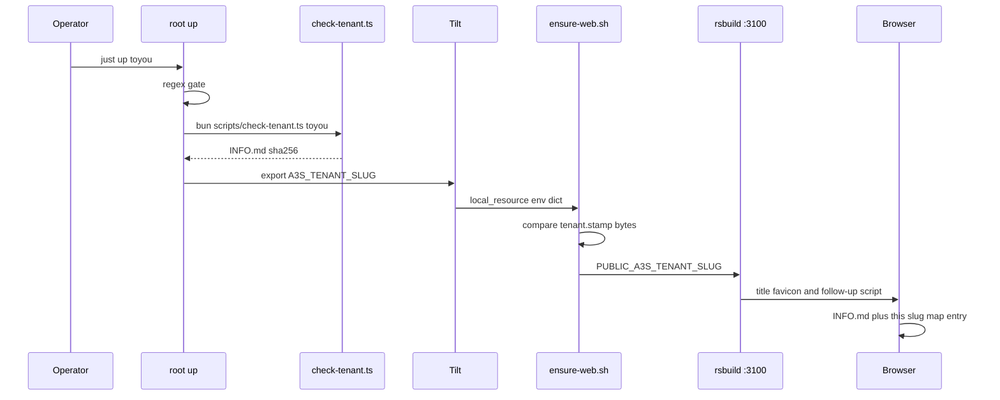
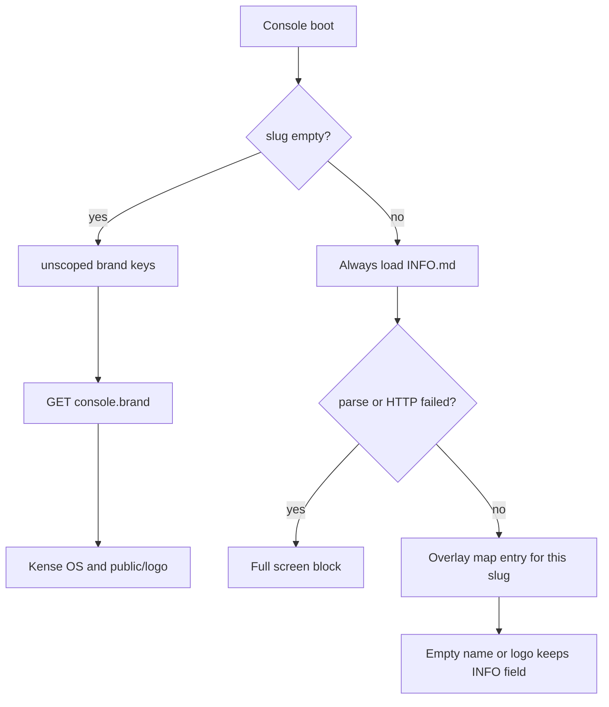

# 启动租户设计（`just up <slug>`）

- 作者：RoyLin
- 日期：2026-09-29
- 状态：Draft
- 范围：仓库根 `just up` 所启动的本地系统。Console（`apps/web`，`127.0.0.1:3100`）上人能看见的平台名称和字标来自租户目录。服务名和进程名使用 `a3s-` 前缀。`kense` 与 `toyou` 都是租户
- 记录：每个租户的名称、字标和品牌色在该目录的 `BRAND.md`，与 `INFO.md` 相邻。已落盘：`apps/web/public/tenant/kense/BRAND.md`、`apps/web/public/tenant/kense/INFO.md`、`apps/web/public/tenant/toyou/BRAND.md`、`apps/web/public/tenant/toyou/INFO.md`。加载器只解析 `INFO.md` 和两张 PNG，不解析 `BRAND.md`，也不把 `BRAND.md` 算进重启哈希。产品控件用仓库根 `DESIGN.md`。本文是加载器的实现说明。服务名和进程名在源码里已经是 `a3s-`。`justfile` 还没有接租户 slug。这一步不启动进程，正在运行的进程仍是改名前的名字，直到下一次启动

## Overview

操作者希望用 `just up:toyou` 选择 `apps/web/public/tenant/toyou`，让根 `just up` 拉起的整套本地系统使用该目录里的字标和 `INFO.md`（平台名称、logo 引用、主题色）。已安装的 just 是 1.58.0。just 的 recipe 名不能包含 `:`，所以 justfile 里不能写一条名为 `up:toyou` 的 recipe。`scripts/dev-bin/just` 在最近的 justfile 是仓库根时，把 `just up:toyou` 改写成 `just up toyou`，再交给 Homebrew just。`just up <slug>` 是 just 自己接受的形式，任意 `apps/web/public/tenant/<slug>` 都走它。

本文把该意图落成一条根 recipe：`up`，位置参数 `$slug`，默认 `toyou`。`just up` 与 `just up toyou` 与 `just up:toyou` 都加载 `apps/web/public/tenant/toyou`。`just up a3s` 与 `just up:a3s` 加载 `apps/web/public/tenant/a3s`。`just up:kense` 与 `just up kense` 都加载 `apps/web/public/tenant/kense`。`just up:toyou` 与 `just up toyou` 都加载 `apps/web/public/tenant/toyou`。每个 slug 都走同一套 `INFO.md`，没有一套写死的 Kense OS 回退。人在 Console 里看见的平台名和字标来自该租户。服务名和进程名改为 `a3s-` 前缀，不随租户改变，也不改成通友科技或 Toyou AI Labs。官方站（`just official`）和 fleet 虚拟机不在 `just up` 里，也不套这层皮肤。

## Background & Motivation

根 `justfile` 的 `up`（约第 22–30 行）在找到 `tilt` 之后执行 `tilt up`。根 `Tiltfile` 用 `docker_compose('./docker-compose.yml')` 拉起共享中间件，再用 `local_resource` 启动宿主机进程。与平台名称相关的现状如下。

| 今天的进程 | 监听 | 今天的服务标题 | 目标进程名 / 服务名 |
| --- | --- | --- | --- |
| `a3s-postgres` / `a3s-redis` / `a3s-iggy` / `a3s-etcd` | `:5432` / `:6379` / `:5102` / `:2379` | 无 | `a3s-postgres` / `a3s-redis` / `a3s-iggy` / `a3s-etcd` |
| `a3s-rustfs` / `a3s-registry` / `a3s-cloud-registry` / `a3s-clickhouse` | `:9000` / `:50030` / `:50020` / `:8123` | 无 | `a3s-rustfs` / `a3s-registry` / `a3s-cloud-registry` / `a3s-clickhouse` |
| `a3s-gateway` | `:8080` | 进程日志写 `Kense Gateway`（`apps/gateway/src/main.rs`） | 进程名 `a3s-gateway`，日志行改为 `a3s-gateway` |
| `a3s-api` | `:3000` | `OpenApiInfo::new("Kense API", …)`，`apps/api/src/main.rs` 约第 204–206 行。`A3S_SERVICE_NAME=a3s-api` | 进程名与 `A3S_SERVICE_NAME` 为 `a3s-api`。`info.title` 改为 `a3s-api` |
| `a3s-config` | `:7652` | `OpenApiInfo::new("Kense Config", …)`，`apps/config/src/main.rs` 约第 63–65 行。`A3S_SERVICE_NAME=a3s-config` | `a3s-config` |
| `a3s-auth` | `:7641` | 无 `OpenApiInfo`。`A3S_SERVICE_NAME=a3s-auth` | `a3s-auth` |
| `a3s-billing` | `:7651` | 无 `OpenApiInfo`。`A3S_SERVICE_NAME=a3s-billing` | `a3s-billing` |
| `a3s-runtime` | `:8787` | 健康 JSON 的 `service` 为 `a3s-runtime` | `a3s-runtime` |
| `a3s-cloud-control-plane` | `:18080`，best-effort | `OpenApiInfo::new("A3S Cloud REST API", …)`，`apps/cloud/crates/control-plane/src/presentation/api_contract/route.rs` 的 `openapi_info()` | 进程名 `a3s-cloud-control-plane`。`info.title` 改为 `a3s-cloud` |
| `a3s-cloud-node-agent` | 节点本机 | 二进制名即进程名 | `a3s-cloud-node-agent`。已在跑的客户机单元不由本文改写 |
| Console dev server | `127.0.0.1:3100` | 平台名、字标、`document.title`、`theme-color` | 进程仍是 rsbuild。可见平台名和字标来自租户 |
| `a3s-cloud-docs` | `:13200` | nginx 挂载 `apps/web/dist` | 容器名 `a3s-cloud-docs`。不是 dev 注入路径 |

服务名和进程名是同一套 `a3s-` 字符串：Compose service、`container_name`、`A3S_SERVICE_NAME`、健康 JSON 的 `service`、点名该进程的日志，以及该服务自己的 OpenAPI `info.title`。这些字符串不随 `toyou` 或 `kense` 改变。Console 把平台品牌（名称和字标）换成当前租户；它回显 `info.title` 或健康字段时，显示的是 `a3s-` 服务名，不把它写成通友科技、氪锶科技或 Kense OS。

Cargo package、Rust crate 和 npm 包名已经改成 `a3s-` / `@a3s/*`：`a3s-api`、`a3s-config`、`a3s-auth`、`a3s-billing`、`a3s-runtime`、`a3s-gateway`、`a3s-cloud-control-plane`、`a3s-cloud-sdk`、`a3s-flow`、`@a3s/web`、`@a3s/ui`。库 `a3s-boot` 与 `a3s-orm` 保持现名。`apps/gateway` 仍是仓库内的数据面程序，包名和 bin 名都是 `a3s-gateway`，依赖表里不得再写一个外部 `a3s-gateway` crate。仍不改的标识：数据库名（`a3s_api`、`a3s_cloud`、`a3s_auth`、`a3s_billing`、`a3s_fence`）、卷名、`A3S_*` 环境变量键、NATS subject、已落库的 Flow 版本号 `a3s-flow-*`、以及 schema `a3s_flow`。

`scripts/spine-status.sh` 把 Console 印成 `http://127.0.0.1:3100`。`scripts/ensure-web.sh` 在 `:3100` 已应答时直接退出（约第 32–37 行），不会把新环境变量送进已经活着的 rsbuild。`apps/cloud/justfile` 第 11 行的 `up` 调用 `./tools/dev/cloud_up.sh`，与根 recipe 不是同一个命令，不得接 slug，根 recipe 也不得转调它。

`just check-gateway-branding` 只跑 `scripts/check-gateway-branding.sh`。它确认 bin 名和包名都是 `a3s-gateway`，并拒绝依赖外部同名 crate。它不是产品品牌加载器，也不扩展成租户加载器。

Console 品牌今天是浏览器偏好，外加配置中心的一份全局值，不是构建期租户：

- `apps/web/src/prefs/store.ts`：`kense.os.theme`、`kense.os.locale`、`kense.os.brandName`、`kense.os.brandLogo`。`DEFAULT_BRAND_NAME` 为 `Kense OS`。`resolveBrandName` 在存储名为空时回到该常量。`applyBrandPrefs` 只接受 `data:image/` logo。`applyThemeColor` 把 meta `theme-color` 写成 `#111112`（dark）和 `#f6f6f6`（light）。`theme` 是外观，不是品牌色板。
- `applyFavicon`：有 data URL 时两套外观共用一张图；否则按表面选文件。`theme === 'dark'` 用 `a3s-icon-dark-*`，否则用 `a3s-icon-light-*`。`packages/ui/src/components/Logo.tsx` 写明文件名里的 `light` / `dark` 指表面：light 表面用深色字标，dark 表面用浅色字标。
- `apps/web/src/shell/BrandMark.tsx`：有 data URL 时用 ``，否则用 `@a3s/ui` 的 `LogoMark`。`useBrandName` 只是 `resolveBrandName`。
- `apps/web/src/prefs/documentTitle.ts`：`${brand} - 管理后台` / `用户中心`（zh），或 `Admin Console` / `User Center`（en）。未登录的 `/` 只有品牌名。
- `apps/web/index.html` 的内联脚本在 bundle 之前用未分域的 `kense.os.brandName` 写 `document.title`，并挂上 Kense favicon。空名回退 `Kense OS`。
- `apps/web/rsbuild.config.ts` 的 `html.title` 为 `Kense OS`，`html.favicon` 为 `public/logo/web-icons/favicon-light.ico`，`theme-color` 为 `#f6f6f6`。客户端环境变量前缀已经是 `PUBLIC_`（例如 `PUBLIC_A3S_API_BASE`）。
- `apps/web/src/App.tsx` 的 `BrandHydrator` 调用 `hydrateBrandFromConfig()`。`apps/web/src/lib/brandConfig.ts` 读写配置中心 namespace `default`、key `console.brand`。`apps/config/src/application/catalog.rs` 将该项描述为控制台显示名称与 Logo，空 name 回退「Kense OS」。`SettingsPage` 的 `SystemSection` 打开时再次 `fetchConsoleBrand`，保存走 `saveConsoleBrand` → `putConfig`。
- 直接渲染 `@a3s/ui` `Logo`、因而今天的 data URL 品牌盖不住的表面：`LoginPage`（`layout="horizontal"`，`alt` 才是 `useBrandName()`）、`OrgLoginPage`、`OrgShell` 侧栏、`PortalPage`（未登录 `/`，由 `orgGuard.tsx` 的 `OrgCenterLayout` 挂上）、`OrgInvitePage`、`OrgJoinPage`。`ActivityBar`、`ApiDocsPage`、`ProfileDialog`、`UserMenu` 走 `BrandMark`。
- `apps/web/src/site/**` 的 `Footer` / `HomePage` 没有被 Console 路由挂载。不改。
- `apps/web/src/lib/oemApi.ts` 的 `brand_name` 是渠道伙伴字段，不是控制台平台名。
- 今天的静态字标在 `apps/web/public/logo/`。启动之后 Console 改用 `apps/web/public/tenant/<slug>/`，不再把这个目录当空 slug 回退。`@a3s/ui` 的 `Logo` 组件仍可读 `public/logo/`，直到调用点换成 `BrandMark`。
- `packages/ui/src/styles.css`：亮色 `--color-primary` 为 `#000000`，`--color-text-link` / `--color-accent` 为 `#0d74ce`。暗色 `--color-primary` 为 `#ffffff`，链接为 `#47c2ff`。根 `DESIGN.md` 规定主 CTA 用黑，蓝色只给链接。暗色主按钮是白，不是黑。两种外观都不得改成租户红。

`apps/web/public/tenant/toyou/` 现有两张 PNG，本任务不改名、不改像素：

- `logo-dark.png`，1417×1417，44688 字节。不透明且非白的像素以 RGB(216, 12, 24) = `#D80C18` 为主。红字 `toyou` 在白底上。
- `logo-light.png`，1417×1417，40315 字节。同一红色几乎铺满整张图。白字 `toyou` 在红底上。

文件名按墨色命名，与 Kense `a3s-icon-light-*`（按表面命名）相反。加载器必须读 `INFO.md` 的键，禁止按文件名里的 `dark` / `light` 去套 `applyFavicon` 的文件名规则。

## Goals & Non-Goals

### Goals

- 根 `just up <slug>` 选择 `apps/web/public/tenant/<slug>`，且全仓库只有这一种目录规则。不为每个租户写一条静态 recipe，不在 `PATH` 上放名为 `just` 的包装。
- slug 字符集锁定为 `^[a-z][a-z0-9-]{0,31}$`（1–32 字符）。非法值在 `tilt up` 之前失败。
- `just up` 的默认 slug 是 `toyou`。`just up toyou`、`just up a3s` 与 `just up kense` 使用同一条加载路径，分别读取 `tenant/toyou`、`tenant/a3s` 与 `tenant/kense`。
- 每个 slug 都只改人能看见的平台品牌：文档标题、favicon、登录字标、活动栏、侧栏品牌、门户与登录链接的 accessible name，以及其他今天显示平台名或平台 logo 的控制台装饰。显示名是该目录 `INFO.md` 的 zh / en 名称（Kense 为氪锶科技 / `Kense OS`，Toyou 为 `通友科技` / `Toyou AI Labs`），字标来自 `apps/web/public/tenant/<slug>/`。品牌层颜色仍只进入 `--color-brand` / `--color-on-brand`。
- 服务名和进程名全部改为上一节的 `a3s-` 目标名。监听端口保持今天的值。
- 换 slug 再启动时，别的 slug 保存过的名称或 logo 不得套用。回到某个 slug 时，该 slug 自己保存过的覆盖还在。存储是 `kense.os.brandOverride` 里的一张 map，不是单个对象。
- 为 Toyou 提供一份小解析器能读的 `INFO.md`。解析器不新增依赖，只用仓库已有的 bash 与 bun。不引入 PyYAML 或 npm YAML 包。

### Non-Goals

- 本文件不实现 recipe、Tilt、`ensure-web.sh` 或 Console 接线。实现顺序见文末 PR Plan。
- 不把 `--color-primary`、链接蓝、权限勾选、PageLoading 改成 `#D80C18`。每个视图仍然只有一个实心主 CTA（亮色黑、暗色白）。
- 不把服务名或进程名改成租户的显示名。`a3s-api` 不叫通友科技，也不叫氪锶科技或 Kense OS。控制台页面若只是回显 `info.title` 或健康 JSON，显示 `a3s-` 服务名。
- 不改数据库名、卷名、`A3S_*` 环境变量键、NATS subject、已落库的 Flow 版本号 `a3s-flow-*` 和 schema `a3s_flow`。Cargo package 与 `@a3s/*` 包名随代码命名一起改为 `a3s`。不把 `apps/gateway` 换成对外部 `a3s-gateway` crate 的依赖。不改已经在客户机上运行的节点单元。
- `Kense Work` 作为 Work 产品名保持；它不是平台字标，也不是进程名。平台品牌来自当前租户的 `INFO.md` 和 logo。
- 不品牌化 `apps/official`，不把 slug 绑到身份组织、登录默认 org、OEM 伙伴或计费。
- 不做按 Host / 子域切租户。一次 `just up` 只有一个进程级默认租户。
- 不改 PNG，不生成第二套红色，不把门户文案 `portal.title`（「致力于将前沿AI技术适配到企业」）换成租户口号。`INFO.md` 不收录地址、电话、口号或用户未给出的法律实体。
- 不改 fleet 机器上已经装好的单元，不改 `deploy/fleet-node/install.sh` 的架构判断，不启动或停止任何进程。`scripts/check-gateway-branding.sh` 里对 `a3s-gateway` 的禁止由改名 PR 删除。

## Proposed Design

### 命令

just 1.58.0 的规则：没有 `$` 前缀的 recipe 参数不会进入 shebang 的环境，也不会变成 `$1`。在 `set -euo pipefail` 下读 `${slug}` 会得到 `slug: unbound variable`，`just up` 和 `just up toyou` 都在正则和 `tilt` 之前以 exit code 1 失败。参数写成 `$slug` 才会导出。`{{slug}}` 是另一条机制，它在 bash 启动前把原始参数插进脚本源码，本设计不用。也不用 just 的 `[arg("slug", pattern=...)]`：除非该 pattern 同时接受空字符串，否则默认的 `just up` 会被拒绝；空值检查留在 bash 里，先看 `-n`，再套正则。

`just --list` 和 `just --show` 只保留 recipe 上方的最后一行注释。`up` 上方的最后一行注释要写明 `just up` 加载 `tenant/toyou`，`just up:a3s` 与 `just up:kense` 加载另外两个目录。后面不能再加注释，否则 `just --list` 不再显示它。

根 `justfile` 采用下面三条 `$slug` recipe。`set shell := ["bash", "-euo", "pipefail", "-c"]` 不作用于 shebang。`web` 也是 shebang，在同一个进程里导出再 `exec`。`just up:toyou`、`just up-ci:toyou`、`just web:toyou` 和 `just work:toyou` 由 `scripts/dev-bin/just` 改写成对应的 `$slug` 调用。just 1.58 解析不到名为 `up:toyou` 的 recipe，这个包装只在仓库根 justfile 上改写。

```just
# `just up` → tenant/toyou. `just up:a3s` → tenant/a3s. `just up:kense` → tenant/kense.
up $slug='toyou':
    #!/usr/bin/env bash
    set -euo pipefail
    if ! [[ "${slug}" =~ ^[a-z][a-z0-9-]{0,31}$ ]]; then
      echo "invalid tenant slug: ${slug}" >&2
      exit 1
    fi
    bun scripts/check-tenant.ts "${slug}" >/dev/null
    if ! command -v tilt >/dev/null 2>&1; then
      echo "tilt not found — install from https://docs.tilt.dev/install.html" >&2
      echo "  macOS: brew install tilt" >&2
      exit 1
    fi
    export A3S_TENANT_SLUG="${slug}"
    tilt up

# Same $slug as up. `just up-ci:toyou` is not a recipe.
up-ci $slug='toyou':
    #!/usr/bin/env bash
    set -euo pipefail
    if ! [[ "${slug}" =~ ^[a-z][a-z0-9-]{0,31}$ ]]; then
      echo "invalid tenant slug: ${slug}" >&2
      exit 1
    fi
    bun scripts/check-tenant.ts "${slug}" >/dev/null
    if ! command -v tilt >/dev/null 2>&1; then
      echo "tilt not found — install from https://docs.tilt.dev/install.html" >&2
      exit 1
    fi
    export A3S_TENANT_SLUG="${slug}"
    tilt ci

# Foreground console. `just web:toyou` is not a recipe. Does not recycle :3100.
web $slug='toyou':
    #!/usr/bin/env bash
    set -euo pipefail
    if ! [[ "${slug}" =~ ^[a-z][a-z0-9-]{0,31}$ ]]; then
      echo "invalid tenant slug: ${slug}" >&2
      exit 1
    fi
    bun scripts/check-tenant.ts "${slug}" >/dev/null
    export A3S_TENANT_SLUG="${slug}"
    export PUBLIC_A3S_TENANT_SLUG="${slug}"
    exec bun --filter @a3s/web dev
```

`$slug='toyou'` 在 shebang 里把 `slug` 导出。省略参数时 just 1.58.0 使用默认值 `toyou`，`just up` 与 `just up toyou` 都先通过 `check-tenant.ts` 再执行 `tilt up`。`just up a3s` 选择 A3S OS，`just up kense` 选择氪锶科技。空字符串不是合法 slug。

`check-tenant.ts` 成功时 stdout 只有哈希。recipe 把 stdout 丢掉，只看 exit code；stderr 仍可见。`ensure-web.sh` 再跑一次并读取 stdout。`down` 不接受 slug。`apps/cloud/justfile` 的 `up` 不接受 slug。

`just web <slug>` 不读、不写 `tenant.stamp`，也不调用 `stop-web.sh`。已经占着 `:3100` 的进程不会被换掉，后起的 `bun` 绑定失败。要切换正在跑的 Console，用 `just up <slug>`。

校验失败、目录不存在、`INFO.md` 不合法时，进程不得执行到 `tilt up` 或 `tilt ci`。

### 从 recipe 到 dev server



Tilt 0.37.7 的 `local_resource` 已有 `env: Dict[str, str] = {}`（`tilt dump api-docs` 的签名）。文档写明这里的值会覆盖传给 Tilt 父进程的同名变量。传递 slug 的机制是这个字典，不是父进程隐式继承，也不是把 slug 拼进 `cmd`。`cmd` 保持 `bash scripts/ensure-web.sh`。slug 不出现在命令行上；操作者看 `ensure-web.sh` 的日志和 `spine-status.sh`。

`Tiltfile` 读取 `os.getenv('A3S_TENANT_SLUG', '')`。空字符串 `fail()`。非空则逐字符检查：长度 1–32，首字符 `a`–`z`，其余只允许 `a`–`z`、`0`–`9`、`-`。不通过就 `fail()`，并且发生在 `local_resource` 之前。Starlark 这段不要用正则库。不要把未通过 `fail()` 的字符串放进 `env`。手跑 Tilt 且没有该变量时失败，不回退成写死的 Kense OS。

```python
def tenant_slug_or_fail():
    raw = os.getenv('A3S_TENANT_SLUG', '')
    if raw == '':
        fail('A3S_TENANT_SLUG is required')
    if len(raw) > 32:
        fail('invalid A3S_TENANT_SLUG')
    first = raw[0]
    if first < 'a' or first > 'z':
        fail('invalid A3S_TENANT_SLUG')
    for ch in raw[1:]:
        letter = ch >= 'a' and ch <= 'z'
        digit = ch >= '0' and ch <= '9'
        if not letter and not digit and ch != '-':
            fail('invalid A3S_TENANT_SLUG')
    return raw

tenant_slug = tenant_slug_or_fail()

local_resource(
    'web',
    cmd='bash scripts/ensure-web.sh',
    env={
        'A3S_TENANT_SLUG': tenant_slug,
        'PUBLIC_A3S_TENANT_SLUG': tenant_slug,
    },
    deps=['apps/web', 'scripts/ensure-web.sh', 'scripts/detach-service.sh', 'scripts/check-tenant.ts', 'scripts/tenant-fs.ts'],
    ignore=['apps/web/.data', 'apps/web/.next', 'apps/web/dist', 'apps/web/node_modules'],
    resource_deps=['api'],
    labels=['spine'],
)
```

recipe 总会写入 `kense` 或调用者给出的 slug，用来盖掉父进程里残留的另一个 slug。

`scripts/ensure-web.sh` 在 `launch_service` 之前再用同一正则校验，并跑 `bun scripts/check-tenant.ts`，捕获 stdout。slug 为空或非法时失败，不启动 Console。`launch_service`（`scripts/detach-service.sh`）用 `setsid` 且不清洗环境，因此 `env` 字典里的 `PUBLIC_A3S_TENANT_SLUG` 会进入 `bun --filter @a3s/web dev`。rsbuild 按既有 `PUBLIC_` 前缀把它暴露为 `import.meta.env.PUBLIC_A3S_TENANT_SLUG`。不要另做 `source.define` 通道。

`ensure-web.sh` 今天在 `:3100` 已应答时并不只是退出。第 32–37 行是：进程还在就记 pid，否则 `remember_listener`，然后 `ensure_ssh_bridge`，再打印并 `exit 0`。`stop-web.sh` 不停止 `:13101` 上的 fleet SSH bridge。stamp 匹配的早退必须保留这次 `ensure_ssh_bridge`。stamp 不符而重启之后，也要再调用 `ensure_ssh_bridge`（今天启动成功路径里已有这一调用，不能省）。

stamp 文件是 `apps/web/.data/tenant.stamp`（仓库根 `.gitignore` 已忽略任意目录下的 `.data/`）。字节合同，没有第三行，没有 `sha256sum` 的文件名：

```text
<line 1: slug>
<line 2: 64 位小写十六进制>
<文件以换行结束>
```

`kense` 或 `toyou` 加哈希 `hhhh…`（64 位）的全部字节是 `printf '%s\n%s\n' <slug> hhhh…` 的输出。比较用 `cmp`，不用去掉文件名的文本处理。stdout 若不是「64 位小写十六进制加一个 LF」，`ensure-web.sh` 失败并且不启动 Console。没有空 slug 的 `printf '\n-\n'` 形式。

文件不存在与本次期望不同。本改动合并后的第一次 `just up` 会重启一次已经健康的 `:3100`，健康成功之后才写入 stamp。之后期望不变就走早退，不再每次重启。从 `kense` 切到 `toyou` 会因为 stamp 第一行不同而重启。

只改 PNG、不改 `INFO.md` 时哈希不变，不重启。字标 URL 稳定。`server.publicDir.watch` 默认是 false，改 PNG 不会自动刷新已经打开的页面。dev server 已经用 sirv 提供 `public/`，包括 `/tenant/`。`@rsbuild/core` 2.2.7 在 `applyDefaultMiddlewares` 里 `use` `publicDirMiddleware`，它调用 `sirv(publicDir, { etag: true, dev: true })`（`node_modules/@rsbuild/core/dist/626.js`）。dev 路径走 `viaLocal`：`Cache-Control` 为 `no-cache`，ETag 为 `W/"${size}-${mtime}"`（同包 `dist/sirv.js` 的 `toHeaders`）。文件存在时 `send()` 直接 `writeHead`，不调用 `next()`。因此 `GET /tenant/<slug>/logo-dark.png` 和 `GET /tenant/<slug>/INFO.md` 在 sirv 里结束。只改 PNG 会改变 size 或 mtime，ETag 跟着变，刷新即可重新校验，不依赖 `INFO.md` 的哈希。不再加 `server.setup` 返回的后置回调：那个返回值是 `postCallback`，在 `publicDirMiddleware` 已经挂上之后才执行，而 sirv 不把已命中的文件交给后面的中间件。也不用全局 `server.headers` 去写只属于 `/tenant/` 的值。不要给 URL 加会在进程启动时冻住的 `?v=`。

`INFO.md` 变化会改变哈希并重启，这样 rsbuild 写进 HTML 的 `html.title` 和后置脚本常量与文件一致。

`scripts/spine-status.sh` 在现有的 `Console → http://127.0.0.1:3100` 旁打印 stamp 第一行：`tenant=<slug>`。不新增指标系统。

`a3s-cloud-docs`（今天的容器名 `a3s-cloud-docs`，`:13200`）服务的是 `apps/web/dist`，不是这次 dev server。操作者看 `:3100`。`rsbuild build` 与 `rsbuild dev` 共用 `rsbuild.config.ts`。未设置变量的 `rsbuild build` 失败，不回退成写死的 Kense OS。本设计的验收只要求 dev server。

### 启动优先级

启动租户是该次 `just up <slug>` 的进程默认值。分域规则如下。

| 来源 | `just up`、`just up kense`、`just up toyou` |
| --- | --- |
| `apps/web/public/tenant/<slug>/INFO.md` | 始终加载。名称、字标、颜色、描述的底稿 |
| `kense.os.brandOverride` | 只读 map 里本次 slug 的条目，按字段盖住名称和 logo |
| `kense.os.brandName` / `kense.os.brandLogo` | 不读，不写，`commit` 也不碰 |
| 配置中心 `default` / `console.brand` | 不 GET，不 PUT。它不再是启动品牌 |
| `DEFAULT_BRAND_NAME`（今天的常量 `Kense OS`）与 `public/logo/` | 不使用。Kense 的名称和字标来自 `tenant/kense`。解析失败时也不回退到这里 |
| OEM `brand_name`、身份组织名 | 不参与平台名 |

存储键：

- `kense.os.theme`、`kense.os.locale`：两种启动共用，不分域。
- `kense.os.brandName`、`kense.os.brandLogo`：不再参与启动。模块初始化不读它们。`commit` 在改 theme 或 locale 时也不得写入或删除它们，否则一次外观切换会把内存里的租户名写回未分域键，下一次 `just up` 会读到。
- `kense.os.brandOverride`：一个 JSON 对象，键是 slug，值是 `{ "name": string, "logo": string | null }`。示例：`{"toyou":{"name":"通友科技","logo":null},"other":{"name":"Other","logo":null}}`。没有顶层 `slug` 字段。保存 slug B 只更新 `map["B"]`，`map["A"]` 保持不变。启动 slug S 只应用 `map[S]`。别的键不应用，也不是「整份 JSON 惰性留到下次被覆盖掉」。`logo` 为 `null`，或 `data:image/` 且长度仍受现有 `MAX_LOGO_BYTES`（450000）约束。不使用 `kense.os.brandName.<slug>` 这种每 slug 一把键。

字段叠加，不是整份替换：

- slug 非空时始终加载 `INFO.md`。`brand`、`on_brand`、`theme_color`、`description` 永远来自 `INFO.md`，覆盖里没有这些字段。
- `map[S].name` 去空白后非空：两种 locale 都显示这一行，不再用 `name.zh` / `name.en`。否则用 `INFO.md` 里当前 locale 的名称。
- `map[S].logo` 是 data URL：两种外观都用这一张图。否则按表面切换 `INFO.md` 的两张 PNG。
- `map[S]` 不存在、JSON 损坏、`name` 不是字符串、或 `logo` 既不是 `null` 也不是 `data:image/`：忽略这一条，不抛到白屏，名称和字标都留在 `INFO.md`。不要因为名字有覆盖就跳过文件加载。
- `name` 空白且 `logo` 为 `null`：从 map 删除 `S`。map 变成 `{}` 时删除整个键。

启动顺序：

1. 读 `import.meta.env.PUBLIC_A3S_TENANT_SLUG`。空、未定义或非法值在 rsbuild 配置阶段就失败，不回退到写死的 Kense OS，也不读 `readBrandName` / `readBrandLogo`。
2. 不读未分域品牌键，不调用 `hydrateBrandFromConfig`。`applyBrandPrefs` 是空操作，避免 `SystemSection` 在 PR 5 之前把配置中心的名字写进内存。`GET /tenant/<slug>/INFO.md` 始终发生。解析结果的 `slug` 必须等于环境变量。`kense` 与 `toyou` 都走这一步。
3. 然后才读 `kense.os.brandOverride`，只取 `map[S]`，按上面的字段规则盖住名称和 logo。
4. 首屏不能等这次 fetch。首屏通道是 rsbuild 在 Node 里读完 `INFO.md` 之后写进 HTML 的字面量，不是一组给提前运行的脚本去 `querySelector` 的 meta。见下一节的文档顺序。bundle 水合后再 fetch 一次。fetch 成功则以 fetch 为准，再叠 `map[S]`，这样只改了 `INFO.md`、进程还没重启时，刷新也能更新名称和颜色。`ensure-web.sh` 的哈希重启让下一次进程的首屏字面量跟上。
5. fetch 或解析失败：全屏阻塞，不渲染 Kense 字标，不把标题设成 `Kense OS`，不提供会 `PUT` `console.brand` 的设置路径。禁止回退。回退会把坏租户伪装成官方皮肤。
6. 设置页草稿初值是叠加之后的名称，以及 data URL 或当前表面的 PNG。不是 `console.brand`。保存只更新 `map[S]`。恢复默认删除 `map[S]`，名称和字标回到 `INFO.md`，颜色本来就在 `INFO.md` 上。不把空 name 写进配置中心。`kense` 与 `toyou` 使用同一条保存路径。

### 首屏文档顺序

`apps/web/dist/index.html` 里，模板脚本是 `<head>` 的第一个节点，解析到它就执行。Rsbuild 2.2.7 随后才发出 `<link rel="icon">`、`<title>`、charset、viewport、description、`<meta name="theme-color" content="#f6f6f6">`，再是 bundle，最后是 `html.tags`（今天的 apple-touch-icon 就在 `</head>` 前）。模板脚本里的 `querySelector('meta[name="theme-color"]')` 因此是空操作。脚本里对 `document.title` 的赋值会被后面的 `<title>` 盖掉。后面的 `<title>` 赢。只让模板脚本去读尚未出现的 `a3s-tenant-*` meta，挡不住 Kense 图标，也挡不住标题回到 `html.title`。

首屏只走这一条通道：

1. 模板脚本仍最先跑。`html.templateParameters` 注入已校验的 `tenantSlug`。脚本仍设置 `data-theme` 和 `lang`；不读 `kense.os.brandName`；不 `appendChild` 任何 `a3s-icon-*`；不写 `document.title`。此时写标题没有意义，后面的 `<title>` 会替换它。没有空 slug 分支。
2. `html.title` 在 slug 非空时是 zh 名称（Toyou 为 `通友科技`）。这是无脚本回退，也是解析器盖过模板脚本之后、后置脚本之前的标题。`html.meta.description` 用 zh 的 `description`。`html.favicon` 与 apple-touch-icon 用 light 表面那张图，Toyou 是 `/tenant/toyou/logo-light.png`。`theme-color` 的静态值用 light 的 `#f6f6f6`。
3. 后置脚本放在 `html.tags`，使用默认的 `append: true`。`@rsbuild/core` 2.2.7 的 `getTagPriority` 给 head 标签 `-2`，`append: true` 再 `+1`，于是它排在插件已经放进 head 的 title、favicon、theme-color 之后，执行时这些节点已经在。脚本正文由 `rsbuild.config.ts` 用 Node 加载器生成，把名称、描述、颜色和两张表面 URL 放进 `JSON.stringify` 的结果，并把结果里的 `<` 换成 `\u003c`。`html.tags` 的 `children` 按 Rsbuild 类型注释是原样插入、不做 HTML 转义，不能把租户字符串直接拼进脚本。这个脚本不 `querySelector` 租户 meta；本设计不发射一套供它读取的 `a3s-tenant-*` meta。
4. 后置脚本按 `kense.os.theme` 和 `kense.os.locale` 调用与 `formatConsoleDocumentTitle` 相同的后缀规则，写入 `document.title`。因为 `<title>` 已经在它前面，这次赋值会留下来。暗色时把已存在的 `rel="icon"` 换成 dark 表面 URL（Toyou 为 `logo-light.png`）。有 `map[S].logo` data URL 时两种外观都用它。`theme-color` 按表面改成 `INFO.md` 的值。`--color-brand` 与 `--color-on-brand` 只来自 `INFO.md`。slug 非空时后置脚本也不读 `kense.os.brandName`。

表面 URL 来自 `INFO.md`。亮色表面用 `logo-light.png`，暗色表面用 `logo-dark.png`。

### 字标映射

与 `applyFavicon` 的表面规则一致，并按 Toyou 文件的实际墨色落地：

- 亮色表面（`data-theme` 不是 `dark`，或调用方传入 `tone="light"`）使用 `logos.light_surface`，即 `logo-light.png`：红底白字 `toyou`。
- 暗色表面使用 `logos.dark_surface`，即 `logo-dark.png`：白底红字 `toyou`。

`BrandMark` 增加与 `Logo` 相同的 `tone?: 'auto' | 'light' | 'dark'` 和 `layout?: 'icon' | 'horizontal' | 'vertical'`。`tone="auto"` 跟随 `document.documentElement.dataset.theme`。`PortalPage` 在产品带上把 header 反色，必须把今天的 `tone={overProduct ? 'dark' : 'light'}` 传进来；只跟 `prefs.theme` 会把白底红字放到深色头上。

没有租户、也没有 data URL 时，`layout` 仍交给 `Logo` / `LogoMark`，Kense 横版宽高比 `106/44` 保持不变。有租户 PNG 或 data URL 时，不套这个宽高比：高度等于 `size`，宽度随正方形图，`object-fit: contain`。两张图都是铺满的正方形字标，压进 106×44 会压扁。活动栏 26px、登录 36–40px、侧栏 32px 都直接缩这张 1417 图。解码约 1417×1417×4 ≈ 8 MB/张，两张约 16 MB，本地 Console 可接受。v1 不做服务器端缩放。

需要从 `Logo` 换成 `BrandMark` 的调用点，以及无障碍名字：

- `PortalPage` header 的 `Link` 今天是 `aria-label="Kense"`，改为解析后的平台名。内部 `Logo` 的 `alt=""` 保持装饰，因为父链接已经有名字。
- 同一页中部字标是 `alt="Kense"`，没有父链接。这个 `alt` 改为平台名。它不是 `aria-label`。
- 同一页 footer 的 `Link` 今天是 `aria-label="Kense"`，改为平台名。内部图保持 `alt=""`。
- `OrgLoginPage` 品牌链接是 `aria-label="Kense"`，`Logo` 为 `alt=""`、高 40。链接的 accessible name 改为平台名，`alt=""` 保持装饰。
- `OrgShell` 已经是 `aria-label={brandName}`，会跟着 `useBrandName`。内部 `alt=""` 保持装饰。
- `LoginPage` 今天把 `brandName` 放在 `Logo` 的 `alt` 上，没有单独的 `aria-label="Kense"`。换成 `BrandMark` 后 `alt` 仍是平台名。
- `OrgInvitePage` 与 `OrgJoinPage` 的 `alt={t('org.brandTag')}` 是「个人中心」 / `Personal Center`，不是平台名，也不是写死的 `Kense`。像素换成 `BrandMark`，`alt` 保持 `org.brandTag`。
- `SettingsPage` 在没有 data URL 时的预览从 `LogoMark` 改为 `BrandMark`。没有覆盖时它必须能按表面显示 PNG，而不是只在有 data URL 时才离开 Kense 字标。
- `OverviewPage` 首页眉题 `overview.eyebrow`（文案是 `Kense OS`）在有租户时改为当前 locale 的平台名。`overview.eyebrow.platform`（`CTO`）不动。

`portal.eyebrow` 这条 i18n 目前没有被 `PortalPage` 渲染。`PRODUCT` 里的 `Kense Work` 是桌面端产品名，不是本次平台皮肤，不替换。`portal.title` 保持原口号。

`resolveBrandName` 变为：本次 slug 的名称覆盖非空则用该覆盖（两种 locale 同一行）；否则有租户则用 `name.zh` / `name.en`（locale `en` 用 en，其余用 zh）；否则 `Kense OS`。未分域的 `kense.os.brandName` 在 slug 非空时不参与。文档标题仍走 `formatConsoleDocumentTitle`，只换品牌段。

`ApiDocsPage` 的工作区标题不是 `` `${brandName} Work API` ``。现有表达式是 `` `${(brandName.replace(/\s+OS$/i, '') || 'Kense').trim()} Work API` ``。这一行保持不动，不把文件列成文案改动。`just up kense` 的英文名 `Kense OS` 仍被剥掉尾部 ` OS`，得到 `Kense Work API`。中文名氪锶科技不以 ` OS` 结尾，得到「氪锶科技 Work API」。改成不剥 ` OS` 的模板会把英文标题变成 `Kense OS Work API`。Toyou 的 `通友科技` 与 `Toyou AI Labs` 都不以 ` OS` 结尾，所以在 `useBrandName()` 换成租户名之后，原表达式自然得到「通友科技 Work API」和「Toyou AI Labs Work API」，不另加格式化。末尾的字面量 `'Kense'` 只在剥完之后为空时出现。slug 非空而 `INFO.md` 失败时是全屏阻塞，`ApiDocsPage` 不挂载，因此这条字面量不会变成坏租户的标题。云文档变体继续用 `apiDocs.cloudTitle`（`A3S Cloud API`），因为它指 Cloud REST 契约，不是 Console 平台名；旁边的 `BrandMark` 仍是租户字标。

`shell.product` 不再充当启动品牌。设置页 placeholder 用当前租户 `INFO.md` 的名称，不用 `t('shell.product')`。`messages.ts` 里的产品目录句子不按租户整份替换。

### 品牌层颜色

租户色是单独一层，不进入 `@theme` 里的 `--color-primary`：

- `--color-brand` = `INFO.md` 的 `brand`。toyou、a3s、kense 都是 `#171717`。
- `--color-on-brand` = `on_brand`。三个租户都是 `#FFFFFF`。

启动后用 `documentElement.style.setProperty` 设置当前租户的品牌色。v1 唯一的消费者是设置页预览上的一枚色样，用来证明值已加载。按钮、链接、权限勾、PageLoading（`--page-loader-accent` 仍是 `--color-ink`）、页面背景都不引用这两个变量。

`theme-color` 继续用现有中性色：亮 `#f6f6f6`，暗 `#111112`。这两个值就是 `applyThemeColor` 和暗色 `--color-bg` 的现色。`theme-color` 画的是浏览器工具条，不是字标。把工具条涂成 `#D80C18` 会让整条浏览器 chrome 变成字标红，并和「红色不充当 CTA / chrome」冲突。不发明第二种红。`INFO.md` 把这两个中性色写死，加载器读字段，不在代码里另写一套 Toyou 常量；Toyou 的值与今天的常量相同。

### `INFO.md` 语法

规范文件名只有 `INFO.md`。加载器不做 `info.md` 的大小写回退。默认 macOS 卷不区分大小写，两者会是同一个文件；Linux CI 区分大小写，因此仓库里的名字必须是 `INFO.md`。同一目录里的 `BRAND.md` 与 `INFO.md` 相邻，只给人读。检查器不要求它存在，解析器不读它，重启哈希不含它。目录里多出这个文件不会让 `check-tenant.ts` 失败。

文本解析与文件系统检查分开。不写第二份 Python 解析器。Python 3.9.6 存在，但本设计不用它解析 YAML。

- `parseTenantInfo(text: string)` 在 `apps/web/src/prefs/tenantInfo.ts`。纯函数。禁止 `node:fs`、`node:path`、`import.meta.env` 和 `@/` 应用 import。浏览器对 `GET /tenant/<slug>/INFO.md` 的正文调用它。它检查文法并返回字段，不访问磁盘，也不知道仓库根目录。
- `scripts/tenant-fs.ts` 只在 Node / bun 里用。`scripts/check-tenant.ts` 和 `apps/web/rsbuild.config.ts` import 它。客户端 bundle 不 import 它。仓库根由本文件位置决定：`scripts/tenant-fs.ts` 的父目录，再 `realpath`。不使用 `process.cwd()`。`bun --filter @a3s/web dev` 的 cwd 是 `apps/web`，cwd 相对路径不稳定。`rsbuild.config.ts` 若自己算根，是该文件再向上两级（`apps/web` → 仓库根），然后同样 `realpath`；优先让 `tenant-fs.ts` 只用自己的位置，避免两套根。
- 期望目录是 `path.join(rootReal, 'apps/web/public/tenant', slug)`。对期望目录和 `INFO.md`、两张 logo 都做 `realpath`，再做前缀比较。符号链接检出时，逻辑路径和 realpath 混比会误拒或误收。目录或 logo 的 `lstat` 若是符号链接，拒绝。`realpath` 结果必须仍在 `rootReal` 之下，并且期望目录的 realpath 必须等于去掉符号链接之后的期望路径。logo 路径只允许单段文件名。

这不是完整 YAML。闭合文法：

- 文件以一行 `---` 开始，front matter 以一行 `---` 结束。之后是正文。
- 不允许 Tab、注释、流式 `{}` / `[]`、多行 `|` / `>`、锚点、标签。
- 允许空行。嵌套只有两层，子键缩进正好两个空格。
- 重复键、未知键、缺键、版本不是整数 `1`：失败。`version` 不加引号。引号包住的 `"1"` 失败。
- 除 `version`、`slug`、两个 logo 文件名外，标量都是双引号 JSON 字符串（本文件不需要转义）。
- `slug` 与 logo 文件名是无引号 token。logo 文件名匹配 `^[a-z0-9][a-z0-9.-]{0,63}$`，且必须以 `.png` 结尾。禁止 `/` 与 `..`。
- 颜色匹配 `^#[0-9A-Fa-f]{6}$`。
- `name.*` 去空白后 1–64 个 Unicode 码位。`description.*` 1–120 个码位，且字符串内无换行。
- 正文 trim 之后非空。正文不参与字段，v1 Console 不渲染正文。
- 纯解析器要求 `slug` 匹配 `^[a-z][a-z0-9-]{0,31}$`。它等于目录名、也等于 CLI 参数，由 `tenant-fs.ts` 检查，不由纯解析器检查。
- `name` 与 `description` 拒绝 `<`、`>`、`&`。规范示例不含这些字符。这是为了 `html.title` 和原样插入的脚本正文，不是新的产品字段。
- 两个 logo 必须是该目录内的常规文件。每个文件 ≤ 524288 字节。Toyou 的 44688 与 40315 字节通过。体积和符号链接检查只在 `tenant-fs.ts`。

键集合只有：`version`、`slug`、`name.zh`、`name.en`、`product`、`logos.light_surface`、`logos.dark_surface`、`brand`、`on_brand`、`theme_color.light`、`theme_color.dark`、`description.zh`、`description.en`。`product` 是桌面产品名，中英文同一行。解析器接受任意键序。已提交的 Toyou 文件使用下面的顺序。

### 规范示例

下列内容是 `apps/web/public/tenant/toyou/INFO.md` 的全部字节（文件末尾一个换行）。

```markdown
---
version: 1
slug: toyou
name:
  zh: "通友科技"
  en: "Toyou AI Labs"
product: "ToWork"
logos:
  light_surface: logo-light.png
  dark_surface: logo-dark.png
brand: "#171717"
on_brand: "#FFFFFF"
theme_color:
  light: "#f6f6f6"
  dark: "#111112"
description:
  zh: "通友科技平台控制台"
  en: "Toyou AI Labs platform console"
---

通友科技（Toyou AI Labs）。控制台字标为 toyou。
```

锁定测试至少包括：`light_surface` 解析为 `logo-light.png`，`dark_surface` 解析为 `logo-dark.png`；亮色 `tenantLogoUrl` 以 `/tenant/toyou/logo-light.png` 结尾，暗色以 `/tenant/toyou/logo-dark.png` 结尾。

### 数据流



颜色、`theme-color` 和描述不经过 `layer` 的替换。`layer` 只盖名称和 logo 中非空的那几项。`block` 不画 Kense 字标，也不打开会写入 `console.brand` 的设置。

## API / Interface Changes

无新的 HTTP 路由。服务名和进程名按 Background 表改为 `a3s-`。`info.title` 分别改为 `a3s-api`、`a3s-config`、`a3s-cloud`。gateway 日志改为 `a3s-gateway`。runtime 健康 JSON 的 `service` 改为 `a3s-runtime`。Console 回显这些字段时显示 `a3s-` 服务名，不改写成租户显示名。

新增的进程环境变量：

```bash
A3S_TENANT_SLUG=toyou
PUBLIC_A3S_TENANT_SLUG=toyou
```

两者都导出本次 slug（默认 `toyou`）。只有 `PUBLIC_A3S_TENANT_SLUG` 进入浏览器 bundle。

`resolveBrandName` 从「空则 `Kense OS`」改为「空则租户当前 locale 的名称，再否则 `Kense OS`」。签名增加可选 locale，默认取 `prefs.locale`。

`BrandMark` 增加可选 `tone` 与 `layout`。无租户且无 data URL 时行为与今天的 `LogoMark` 一致；传入 `layout` 时无租户回退改为 `Logo`，这样登录页和侧栏在 `just up` 下仍是 Kense 横版字标。

设置保存：

```ts
type BrandOverrideEntry = { name: string; logo: string | null }
type BrandOverrideMap = Record<string, BrandOverrideEntry>

// slug === ''
await saveConsoleBrand({ name, logo_data_url }) // 今天：PUT default/console.brand，并 applyBrandPrefs

// slug !== ''
const map: BrandOverrideMap = readOverrideMap() // 损坏则当成 {}
const next = { ...map, [slug]: { name: name.trim(), logo } }
// name 空白且 logo === null 时删除 next[slug]
localStorage.setItem('kense.os.brandOverride', JSON.stringify(next))
// 不调用 putConfig。别的 slug 的条目保留。
```

`settings.brand.nameHint`（「留空则恢复默认名称「Kense OS」。」）、`logoHint`（承诺同步到配置中心）、`loadError` / `saveError` / `syncing` 在租户启动下不能再这么说。组件使用新的提示键，不把 Toyou 或 Kense 写进某一条租户专用句子。恢复默认是回到本次 slug 的 `INFO.md`。

## Data Model Changes

无数据库迁移，无配置中心 schema 变更。`console.brand` 的 JSON（`name`、`logo_data_url`）保持 `brandConfig.ts` 与 `catalog.rs` 的形状。slug 启动只是不调用它。

租户记录是 `INFO.md` 加同目录 PNG，不是表。浏览器侧新键只有 `kense.os.brandOverride`。运行时 stamp 是 `apps/web/.data/tenant.stamp`，不入库。

身份库里的组织「通友科技」与这次启动 slug 没有外键。登录仍由 `LoginPage` 的 `pickLoginOrgId` 选择官方组织。

## Alternatives Considered

1. 每个租户一条静态 recipe，例如真的写 `up:toyou`。否决。just 1.58 把 `just up:toyou` 当作 recipe 名查找，body 不会运行；目录增多时也无法在查找阶段现造 recipe。用户要求的是一条规则覆盖任意 slug。
2. 在 `PATH` 上放一个叫 `just` 的包装，把 `up:toyou` 改写成 `up toyou`。采用，文件是 `scripts/dev-bin/just`。最近的 justfile 不是仓库根时，包括 `apps/cloud/justfile`，参数原样交给 Homebrew just；仓库外同样原样通过。zsh 会记住第一次解析到的 `/opt/homebrew/bin/just`。该路径现在是转到 `scripts/dev-bin/just` 的脚本，Cellar 里的二进制仍在 `../Cellar/just/1.58.0/bin/just`。`~/.zshrc` 的 `just` 函数也用绝对路径调用这个包装。
3. 启动时把租户 PNG 拷进 `apps/web/public/logo/`，替换共享字标。否决。切回另一个租户还要再拷一次，租户字节和共享字标混在同一目录。每个租户的字标留在自己的目录。
4. 启动时把 `INFO.md` 写进配置中心 `default/console.brand`，让现成的 `hydrateBrandFromConfig` 生效。否决。该键是所有浏览器共享的 Postgres 值，下一次别的 slug 也会读到这次写入；它存的是 data URL 而不是文件路径。启动租户是进程默认值，不是一次配置中心写入。
5. 扩展 `scripts/check-gateway-branding.sh` 来加载产品品牌。否决。该脚本只搜索旧 gateway 名字 `a3s-gateway`。职责不同，混进去会让品牌门禁和产品皮肤绑死。

## Security & Privacy

威胁模型是本地操作者的 dev 机器，不是多租户 SaaS。Console 只绑 `127.0.0.1:3100`。仍要防止 slug 变成路径或 shell 注入。

- slug 在 `just`、Tiltfile、`ensure-web.sh`、`tenant-fs.ts` 四处使用同一字符集。任何一次失败都在拼接路径之前退出。Tilt 不把 slug 拼进 `cmd`。`env` 字典在 `fail()` 之后才写入，并且空字符串也会写入，以覆盖父进程残留值。
- `tenant-fs.ts` 用自己的文件位置得到仓库根，再 `realpath`。期望目录和候选文件都 `realpath` 之后做前缀比较。符号链接拒绝。logo 路径只允许单段文件名。
- `INFO.md` 和 PNG 位于 `public/`，dev server 上任意本机页面都能 `GET /tenant/toyou/INFO.md`。字段里没有密钥、令牌或个人信息。禁止把凭据写进这个文件。正文也不要写未公开的地址或电话；规范示例里没有。
- 浏览器覆盖的 logo 仍只接受 `data:image/`，上限仍是 `MAX_LOGO_BYTES`。启动字标用 URL，不把 1417 的 PNG 塞进 `localStorage`。
- 平台名写进 `document.title` 和 React 文本，不走 `innerHTML`。CSS 变量只接受已校验的 `#` + 6 位十六进制。
- 不新增认证面，不改变 `a3s_us_` / `a3s_ms_` 会话，不把 slug 放进 API token。
- 官方站与 fleet 不读这个环境变量，避免一个 dev 口令改写另一套产品的对外名称。

## Observability

- `check-tenant.ts` 失败时 stderr 包含 slug、文件路径和字段名，exit code 1。用法错误 exit code 2。成功时 stdout 的全部字节是 64 位小写十六进制再加一个 LF，没有文件名，没有第二行。`ensure-web.sh` 用这段作为 stamp 的第二行。不要调用 `sha256sum`，它的默认行是哈希、两个空格和文件名，多出来的字节会让每次比较都失败并 `stop-web.sh`。
- `ensure-web.sh` 在现有的 `starting kense console on :3100` 旁加上 `tenant=<slug>` 或 `tenant=(default)`。因 stamp 不符而重启时打一行 `tenant stamp changed, restarting console`。匹配早退仍调用 `ensure_ssh_bridge`，并保留今天的 `kense console already answering on :3100`。
- web 资源的 `cmd` 不带 slug。slug 在 `env` 字典里。操作者看上述日志和 `spine-status.sh`，不靠命令行拼出来的变量。
- `spine-status.sh` 的 ready 段打印 tenant。不新增 Prometheus、日志管道或告警。这是本机 Tilt，不是线上 SLO。
- 浏览器在 slug 非空且 `INFO.md` 解析或 HTTP 失败时 `console.error` 带上 slug，并显示全屏阻塞。不画 Kense 字标，不打开 `console.brand` 写入。禁止静默回退。不增加远程遥测。

验收时不要为了看皮肤去跑 `just up` 以外的启动器。实现阶段的检查命令是 `bun scripts/check-tenant.ts toyou`、`bun test` 中的解析与优先级用例，以及一次 `just up toyou`（实现 PR 自己的事，不是本文的任务）。非法 slug 必须在出现 Tilt 进程之前退出。

## Rollout Plan

没有功能开关服务。开关就是参数。回到 Kense 皮肤是 `just up` 或 `just up kense`，加载 `tenant/kense`。回到通友是 `just up toyou`。没有空 slug 回退。

已落盘的 `INFO.md` 在加载器合并前是惰性的。rsbuild 不会因为 `public/` 里多了一个 markdown 就改变 Kense 皮肤。因此可以先合并记录与解析器，再合并启动链，最后才改像素。

分阶段：

1. 纯解析器、`tenant-fs.ts` 与 Toyou 记录。`just up` 行为不变。
2. recipe、Tilt `env`、`ensure-web.sh`。此时 Console 仍显示 Kense，但非法 slug 进不了 Tilt。stamp 缺失会重启一次已经健康的 `:3100`，然后写入 stamp。匹配路径保留 `ensure_ssh_bridge`。
3. 首屏脚本、`store.ts` 的失败关闭、favicon、`theme-color`、品牌层变量、`BrandMark`。这一步就停止读取和写入未分域品牌键，并停止 `hydrateBrandFromConfig`。活动栏和标题变为租户，且不会被配置中心盖回去。登录页等直接使用 `Logo` 的表面仍是 Kense，直到下一步。设置表单仍可显示旧草稿，但保存不得 `PUT` `console.brand`，`applyBrandPrefs` 在 slug 非空时为空操作。
4. 换掉 Console 里那些直接的 `Logo` 调用，并改掉写死的 `Kense` accessible name。
5. 设置表单、override map 的读写，以及新的提示文案。不把失败关闭再推迟到这一步。

每步都可单独回滚。第 2 步回滚只是恢复早退的健康检查，不会留下必须迁移的数据。`kense.os.brandOverride` 在旧 bundle 上会被忽略。

风险：

| 风险 | 严重性 | 缓解 |
| --- | --- | --- |
| 操作者输入 `just up:toyou`，Homebrew just 找不到这个 recipe 名 | 高（使用预期） | `scripts/dev-bin/just` 把第一个位置参数 `up:<slug>` 改写成 `up <slug>`（`up-ci`、`web`、`work` 相同），前面的标志保留，然后执行 Cellar 里的 just 二进制。已打开的 zsh 记住的路径是 `/opt/homebrew/bin/just`，该路径现在是转到仓库包装的脚本。`brew reinstall just` 会把这个路径还原成 Cellar 符号链接 |
| 裸 `slug` 参数使 `just up` 在 `tilt` 前退出 | 高 | recipe 写成 `$slug`；空值先看 `-n` 再套正则 |
| `:3100` 已在跑，新 slug 不生效 | 高 | 健康早退前按字节比较 `tenant.stamp`，不符则 `stop-web.sh`，两条路径都调用 `ensure_ssh_bridge` |
| `just web <slug>` 换不掉已有 Console | 中 | 该 recipe 不用 stamp；切换正在跑的进程用 `just up <slug>` |
| `console.brand` 或未分域 localStorage 盖住新租户 | 高 | PR 3 就不读不写这两处，`commit` 在改 theme 时也不写；覆盖是 map，只应用当前 slug |
| 保存另一个 slug 冲掉上一个覆盖 | 高 | map 按 slug 更新条目，不替换整份对象 |
| 只有名称覆盖时丢掉 PNG 和品牌色 | 高 | 始终加载 `INFO.md`；覆盖按字段叠加 |
| slug 路径穿越或 Tilt 命令注入 | 高 | 同一字符集四处拦截；`realpath` 两侧比较；slug 不进入 `cmd` |
| `#D80C18` 被接成主按钮或链接 | 中 | 不写 `--color-primary` / `--color-text-link`；测试锁住这两个 token |
| 首屏闪成 `Kense OS` | 中 | `html.title` 用 zh 名称；模板脚本在 slug 非空时不挂 Kense 图标、不读未分域品牌；后置脚本在 `<title>` 之后改标题 |
| 正方形字标被按 106/44 拉扁 | 低 | 有租户时高度约束、不套 Kense 宽高比 |
| APFS 不区分大小写，Linux 区分 | 中 | 只打开 `INFO.md` |
| 把 OEM `brand_name` 或组织「通友科技」当成启动租户 | 中 | 非目标里写明二者不绑定 |
| `INFO.md` 可被本机 GET | 低 | 无秘密；只绑 loopback |

## Open Questions

无。命令拼写、slug 字符集、`INFO.md` 字段、表面与文件的对应、`theme-color` 取中性色、以及 localStorage / 配置中心的优先级都已在 Key Decisions 中定稿。

## References

- 根 `justfile`：`up`（约第 22–30 行）、`web`、`up-ci`、`down`、`check-gateway-branding`
- 根 `Tiltfile`：`web` local_resource（约第 97–104 行），`cmd='bash scripts/ensure-web.sh'`
- `scripts/ensure-web.sh`、`scripts/detach-service.sh` 的 `launch_service`、`scripts/spine-status.sh`（Console 行约第 90–91、120 行）
- `scripts/check-gateway-branding.sh`：只禁止 `a3s-gateway`
- `apps/cloud/justfile`：`up` 约第 11 行，调用 `./tools/dev/cloud_up.sh`
- `apps/web/src/prefs/store.ts`、`apps/web/src/prefs/documentTitle.ts`、`apps/web/index.html`、`apps/web/rsbuild.config.ts`
- `apps/web/src/shell/BrandMark.tsx`、`packages/ui/src/components/Logo.tsx`、`packages/ui/src/styles.css`
- `apps/web/src/lib/brandConfig.ts`、`apps/web/src/App.tsx` 的 `BrandHydrator`、`apps/config/src/application/catalog.rs` 的 `console.brand`
- `apps/web/src/pages/LoginPage.tsx`、`OrgLoginPage.tsx`、`org/OrgShell.tsx`、`PortalPage.tsx`、`org/orgGuard.tsx`
- OpenAPI 标题：`apps/api/src/main.rs`、`apps/config/src/main.rs`、`apps/cloud/crates/control-plane/src/presentation/api_contract/route.rs`
- 根 `DESIGN.md`：主 CTA 为黑，链接为 `#0d74ce`
- just 1.58.0：recipe 参数是独立 argv。shebang 只有 `$slug` 这种带 `$` 的参数才会导出。`just --list` 只保留 recipe 上方最后一行注释。Tilt 0.37.7 `local_resource` 的 `env: Dict[str, str]` 覆盖父进程同名变量
- `@rsbuild/core` 2.2.7：`dist/626.js` 的 `publicDirMiddleware` 使用 `sirv(publicDir, { etag: true, dev: true })`。`dist/sirv.js` 在 dev 下设置 `Cache-Control: no-cache`，ETag 为 `W/"${size}-${mtime}"`。`server.setup` 的返回值是 `postCallback`，排在该中间件之后

## Key Decisions

1. **`just up:toyou` 和 `just up toyou` 都加载 `apps/web/public/tenant/toyou`。** just 1.58.0 的 recipe 名不能包含 `:`，所以 justfile 里的 recipe 是 `up $slug='toyou'`。`scripts/dev-bin/just` 把 `up:<slug>`、`up-ci:<slug>`、`web:<slug>`、`work:<slug>` 改写成位置参数；`--dry-run` 这类标志留在配方名前面，`--show` / `--usage` 只改写成配方名。shebang 参数必须写成 `$slug` 才会导出；裸 `slug` 在 `set -u` 下对 `just up` 也是 unbound。不用 `{{slug}}` 插进脚本源码。`up-ci` 与 `web` 使用同一 `$slug`，并且 `web` 是 shebang，否则 `export` 进不了 `bun`。不为每个目录复制一份 tilt 脚本。包装只改写仓库根 justfile 上的 `up`、`up-ci`、`web`、`work` 这四种前缀，然后执行 Cellar 里的 just 二进制。已打开的 zsh 记住的 `/opt/homebrew/bin/just` 是转到这个包装的脚本，所以当前终端直接执行 `just up:toyou` 就会改写。`~/.zshrc` 里的 `just` 函数同样调用包装。
2. **slug 字符集是 `^[a-z][a-z0-9-]{0,31}$`。** 非法值在 `tilt up` 之前失败。Tilt 用 `env` 字典传递，不把 slug 拼进 `cmd`。`fail()` 发生在 `local_resource` 之前。空字符串直接 `fail()`。recipe 写入的值是 `a3s` 或调用者给出的 slug，用来覆盖父进程残留值。
3. **默认 slug 是 `toyou`。A3S 与 Kense 仍是租户。** `just up` 与 `just up toyou` 加载 `apps/web/public/tenant/toyou/INFO.md` 和该目录的两张 PNG。中文名是通友科技，英文名是 `Toyou AI Labs`，品牌色 `#171717`。`just up a3s` 加载 A3S OS，品牌色 `#171717`。`just up kense` 加载氪锶科技 / `Kense OS`，品牌色 `#171717`。没有空 slug，也没有写死在 `DEFAULT_BRAND_NAME` 里的第二套皮肤。合并 stamp 之后的第一次 `just up` 会重启一次已健康的 `:3100`，这是 stamp 从无到有。
4. **每个 slug 的进程默认值都是该目录的 `INFO.md`，并且始终加载。** 未分域的 `kense.os.brandName` / `kense.os.brandLogo` 不读不写，`commit` 改 theme 时也不写。配置中心 `default/console.brand` 也不读不写。这几条在 PR 3 就生效，不等设置表单。代码比任务说明多一条掩盖路径：`BrandHydrator` 与 `SystemSection` 会用配置中心盖住本地偏好。若不切断，上一次保存在 Postgres 里的 OEM 名会盖住当前租户，包括 Kense。
5. **浏览器覆盖是 `kense.os.brandOverride` 里的 map：`{ "<slug>": { "name", "logo" } }`。** 只应用本次启动 slug 的条目。保存另一个 slug 不删除原来的条目，回到原来的 slug 时覆盖还在。不匹配的条目永不应用。名称和 logo 按字段盖住 `INFO.md`；颜色、`theme-color` 和描述始终来自 `INFO.md`。设置仍是单名称、单 logo，与现有表单一致；不在设置里做双语或双外观上传。
6. **`INFO.md` 使用上文闭合 front matter，版本字段 `version: 1`。** 未知键失败，避免自由主题转储。`parseTenantInfo` 是纯函数。`realpath`、体积和符号链接在 `scripts/tenant-fs.ts`，仓库根来自该文件位置而不是 cwd。不引入 YAML 依赖，也不写第二份 Python。正文给人读，不进运行时字段。`check-tenant.ts` 成功时 stdout 只有 64 位小写十六进制和一个 LF。
7. **亮色用 `logo-light.png`，暗色用 `logo-dark.png`。** 文件名跟表面走。`logos.light_surface` 指向 `logo-light.png`，`logos.dark_surface` 指向 `logo-dark.png`。`PortalPage` 必须能传入与 `data-theme` 不同的 `tone`。PNG 字节变化不重启进程。dev 已由 sirv 以 `Cache-Control: no-cache` 和 size-mtime 的 ETag 提供 `public/`（含 `/tenant/`）。只改 PNG 会改变 ETag，刷新即可重新校验。不另写 `server.setup` 中间件，也不用全局 `server.headers`。
8. **`theme-color` 保持 `#f6f6f6` / `#111112`。品牌色只做 `--color-brand` 与 `--color-on-brand`。** toyou、a3s、kense 都是 `#171717` / `#FFFFFF`。不替换亮色 `#000000` 或暗色 `#ffffff` 的 `--color-primary`，也不替换链接蓝。暗色主按钮今天就是白，本设计不把它改回黑，也不改成租户色。
9. **服务名和进程名使用 `a3s-`；Kense 只作为租户出现在人能看见的平台品牌上。** 进程名、Compose service、`container_name`、`A3S_SERVICE_NAME`、健康 JSON 的 `service`、点名进程的日志，以及各服务自己的 OpenAPI `info.title`，改成 Background 表里的 `a3s-` 目标名：`a3s-api`、`a3s-config`、`a3s-auth`、`a3s-billing`、`a3s-runtime`、`a3s-gateway`、`a3s-cloud-control-plane`（`info.title` 为 `a3s-cloud`）、`a3s-cloud-node-agent`，以及中间件容器 `a3s-postgres`、`a3s-redis`、`a3s-nats`、`a3s-etcd`、`a3s-rustfs`、`a3s-registry`、`a3s-cloud-registry`、`a3s-clickhouse`、`a3s-cloud-docs`。这些名字不随租户变化。Cargo package 与 `@a3s/*` 包名使用同一套 `a3s` 名字。数据库名、卷名、`A3S_*` 键、NATS subject、已落库的 Flow 版本号 `a3s-flow-*` 和 schema `a3s_flow` 不改。`apps/gateway` 仍是仓库内程序，包名是 `a3s-gateway`，不依赖外部同名 crate。`check-gateway-branding.sh` 对 `a3s-gateway` 的禁止删除。Console 上人看见的平台品牌来自当前租户：文档标题、favicon、登录字标、活动栏、侧栏品牌、门户与登录链接的 accessible name。Kense 的显示名是氪锶科技 / `Kense OS`，字标在 `apps/web/public/tenant/kense/`。Toyou 的显示名是通友科技 / Toyou AI Labs。工作区 API 标题保持现有的 `brandName.replace(/\s+OS$/i, '')` 表达式，所以英文 `Kense OS` 显示为 `Kense Work API`，中文氪锶科技显示为「氪锶科技 Work API」，通友科技显示为「通友科技 Work API」。`Kense Work` 产品文案保持。官方站不在 `just up` 内，不品牌化。
10. **启动租户不绑定身份组织或 OEM 伙伴。** `oemApi.ts` 的 `brand_name` 仍是渠道记录。登录组织选择逻辑不变。
11. **首屏标题的权威是后置于 `<title>` 的脚本，无脚本回退是 `html.title` 的 zh 名称。** 模板脚本在 slug 非空时不读未分域品牌、不挂 Kense 图标、不写会被后面 `<title>` 盖掉的 `document.title`。不依赖当时还不存在的 meta。

## PR Plan

PR 0 只改服务名和进程名。PR 1 起只改 Console 上人能看见的平台名和字标，不把服务名改成租户显示名。

### PR 0 — 服务名与进程名改为 `a3s-`

- 标题：`Rename service and process names to the a3s- prefix`
- 文件 / 组件：根 `docker-compose.yml` 的 service 与 `container_name`；`scripts/ensure-api.sh`、`ensure-config.sh`、`ensure-auth.sh`、`ensure-billing.sh` 的 `A3S_SERVICE_NAME`；`apps/api/src/main.rs`、`apps/config/src/main.rs`、Cloud `openapi_info()` 的 `info.title`；`apps/gateway/src/main.rs` 的日志行；runtime 健康 JSON 的 `service`；控制面与节点代理的二进制进程名；`scripts/check-gateway-branding.sh`
- 依赖：无
- 说明：源码里的进程名、服务名、Cargo package、Rust crate 和 `@a3s/*` 包名已经是 `a3s`。数据库名、卷名、`A3S_*` 键、NATS subject、已落库的 Flow 版本号和 schema `a3s_flow` 保持原样。`apps/gateway` 仍编仓库内的程序，包名和 bin 名都是 `a3s-gateway`，不依赖外部同名 crate。不改已经在客户机上运行的节点单元，不启动或停止进程。下一次启动才会用上新名字。

### PR 1 — 租户 `INFO.md` 解析器与 Kense、Toyou 记录

- 标题：`Add closed INFO.md parser for launch tenants`
- 文件 / 组件：`apps/web/src/prefs/tenantInfo.ts`、`apps/web/src/prefs/tenantInfo.test.ts`、`scripts/tenant-fs.ts`、`scripts/check-tenant.ts`、已存在的 `apps/web/public/tenant/kense/INFO.md`、`apps/web/public/tenant/kense/BRAND.md`、`apps/web/public/tenant/toyou/INFO.md`、`apps/web/public/tenant/toyou/BRAND.md` 与各自的两张 PNG、`apps/web/docs/tenant/loader.md`
- 依赖：无。与 PR 0 可并行
- 说明：纯函数解析闭合 front matter，不含 `node:fs`。路径、`realpath`、符号链接和 524288 字节上限在 `tenant-fs.ts`，仓库根取该文件的父目录。`bun scripts/check-tenant.ts kense` 与 `bun scripts/check-tenant.ts toyou` 成功时 stdout 只有 64 位小写十六进制和一个 LF；非法 slug、未知键、逃逸路径走 stderr 并以非零退出。表面映射测试：亮色 → `logo-dark.png`，暗色 → `logo-light.png`。不改 `justfile`、Tilt 或 React 树。Console 外观不变，可独立合并。

### PR 2 — 根 `up` 的可选 slug 与 Console 重启戳

- 标题：`Pass launch tenant slug from just up into ensure-web`
- 文件 / 组件：根 `justfile` 的 `up`、`up-ci`、`web`；根 `Tiltfile` 的 `web` local_resource；`scripts/ensure-web.sh`；`scripts/spine-status.sh`
- 依赖：PR 1
- 说明：三条 recipe 都写成 `$slug='toyou'`。`just up`、`just up a3s` 与 `just up kense` 都在 `tilt up` 前跑检查脚本并导出 `A3S_TENANT_SLUG`。`just up` 加载 `tenant/toyou`。空字符串失败。Tiltfile 在 `fail()` 通过后用 `local_resource` 的 `env` 字典传入两个变量，`cmd` 仍是 `bash scripts/ensure-web.sh`。`ensure-web.sh` 按字节比较 `tenant.stamp`。文件缺失会重启一次。匹配早退和重启路径都调用 `ensure_ssh_bridge`。`just web <slug>` 不使用 stamp，也不回收已有的 `:3100`。此 PR 之后界面仍是今天的字标，但错误 slug 不会启动 Tilt。不改 `apps/cloud/justfile`。

### PR 3 — Console 首屏、偏好与 `BrandMark`

- 标题：`Apply launch tenant to document title, favicon, and BrandMark`
- 文件 / 组件：`apps/web/rsbuild.config.ts`（`templateParameters`、`html.title`、`html.favicon`、后置 `html.tags` 脚本）、`apps/web/index.html`、`apps/web/src/prefs/store.ts`、`apps/web/src/App.tsx` 的 `BrandHydrator`、`apps/web/src/lib/brandConfig.ts` 里让非空 slug 的 `applyBrandPrefs` / `saveConsoleBrand` 变成空操作、`apps/web/src/shell/BrandMark.tsx`，以及 store / 标题测试
- 依赖：PR 1。与 PR 2 可并行开发；运行时要看到皮肤则需要 PR 2 的环境变量，测试可以用 `import.meta.env` 桩
- 说明：slug 非空时始终加载 `INFO.md`。模板脚本不读未分域品牌、不挂 Kense 图标、不写会被后面 `<title>` 盖掉的标题。`html.title` 是 zh 名称。后置脚本在 title 与 favicon 之后按表面改标题、图标和 `theme-color`，并设置 `--color-brand`。不改 `--color-primary`。`store.ts` 初始化不读未分域品牌键，`commit` 不写它们，`BrandHydrator` 不调用 `hydrateBrandFromConfig`。解析或 HTTP 失败是全屏阻塞，没有 Kense 字标，也没有写入 `console.brand` 的路径。`BrandMark` 接受 `tone` 与 `layout`，按表面选 PNG。活动栏和 `<head>` 在这一步变成租户，并且不会被配置中心盖回去。override map 的表单留到 PR 5；这一步没有 map 条目时就是纯 `INFO.md`。直接使用 `Logo` 的登录页和门户留到 PR 4。不改 `ApiDocsPage.tsx` 的标题表达式。不新增 `server.setup` 中间件；`/tenant/` 的 `Cache-Control: no-cache` 和 size-mtime ETag 已经由 sirv 提供。本 PR 不改服务名、OpenAPI `info.title`、健康 JSON 或日志行。

### PR 4 — 换掉仍硬编码的 Kense `Logo`

- 标题：`Use BrandMark on login, portal, and org chrome`
- 文件 / 组件：`apps/web/src/pages/LoginPage.tsx`、`apps/web/src/pages/org/OrgLoginPage.tsx`、`apps/web/src/pages/org/OrgShell.tsx`、`apps/web/src/pages/PortalPage.tsx`、`apps/web/src/pages/org/OrgInvitePage.tsx`、`apps/web/src/pages/org/OrgJoinPage.tsx`、`apps/web/src/pages/OverviewPage.tsx`（仅首页眉题）、`apps/web/src/pages/SettingsPage.tsx` 的预览回退
- 依赖：PR 3
- 说明：上述调用从 `@a3s/ui` 的 `Logo` / `LogoMark` 改为 `BrandMark`，并传入原有 `layout` 与门户 header 的 `tone`。`PortalPage` 的 header `aria-label`、中部 `alt="Kense"`、footer `aria-label`，以及 `OrgLoginPage` 链接的 `aria-label="Kense"`，改为解析后的平台名。父链接已经有名字时，内部图保持 `alt=""`。`OrgShell` 继续用 `aria-label={brandName}`。邀请页和加入页的 `alt` 保持 `org.brandTag`（个人中心），只换像素。不改 `packages/ui` 的 `Logo.tsx`，不改未挂载的 `apps/web/src/site/**`，不改 `Kense Work` 产品文案和 `portal.title`，不改 `a3s-` 服务名。可独立审查：这些调用点使用当前租户的平台名和正方形字标，没有 106/44 拉伸。`just up kense` 的中文界面显示氪锶科技，英文界面显示 Kense OS，字标用 `tenant/kense`。

### PR 5 — 按 slug 分域的设置覆盖

- 标题：`Scope console brand overrides to the launch slug`
- 文件 / 组件：`apps/web/src/pages/SettingsPage.tsx`（`SystemSection` 的表单）、`apps/web/src/prefs/store.ts` 里读写 override map 的部分、`apps/web/src/i18n/messages.ts` 里新增的提示键、对应测试
- 依赖：PR 3。与 PR 4 无代码依赖，可并行
- 说明：失败关闭已经在 PR 3。这一步只加设置表单：草稿来自 `INFO.md` 叠加 `map[slug]`，保存更新该条目而不是替换整份 map，恢复默认删除该条目。名称覆盖不取消 PNG 和 `INFO.md` 的品牌色。测试覆盖：未分域键里的旧名称不得在 `kense` 或 `toyou` 启动时出现；别的 slug 的条目不应用；保存第二个 slug 后回到第一个 slug 仍看到第一条覆盖；清空后名称和字标回到该 slug 的 `INFO.md`，颜色仍在。提示文案不再声称会同步配置中心。
